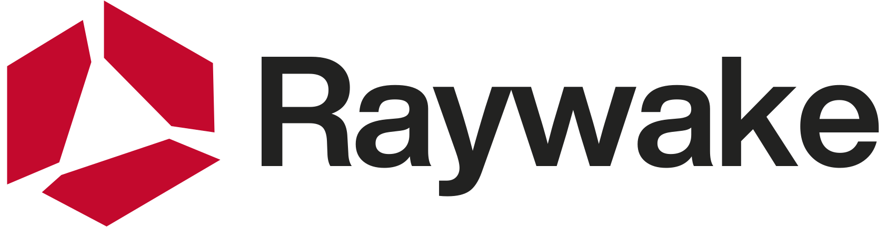
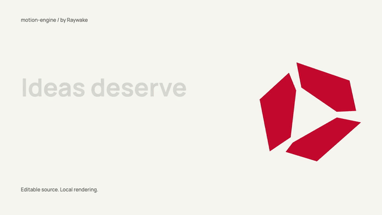

<p align="center">
  <a href="https://raywake.si/?utm_source=github&utm_medium=motion-engine&utm_campaign=oss&utm_content=readme-logo">
    <picture><source media="(prefers-color-scheme: dark)" srcset="assets/brand/raywake-logo-dark.svg"></picture>
  </a>
</p>
<h1 align="center">motion-engine</h1>
<p align="center">Editable launch films. AI media when you need it.</p>
<p align="center"><a href="https://github.com/oguzhankayan/motion-engine/actions/workflows/ci.yml"></a> <a href="LICENSE"></a>  <a href="https://raywake.si/?utm_source=github&utm_medium=motion-engine&utm_campaign=oss&utm_content=badge"></a></p>

**Make a product launch film from editable HTML and JavaScript. Render it locally, add image, video and audio from Raywake, and keep the complete source.**

[](docs/assets/launch.mp4)

[Theme showcase](https://oguzhankayan.github.io/motion-engine/showcase/) · [Live demo](https://oguzhankayan.github.io/motion-engine/) · [Watch the MP4](docs/assets/launch.mp4) · [Türkçe](README.tr.md) · [Raywake integration](docs/RAYWAKE.md) · [Verification](docs/VERIFICATION.md)

The 12-second demo runs **without an API key, an AI subscription or a paid generation**. Its graphics are drawn locally and its sound effects are synthesized. Optional AI generation uses your own Raywake balance.

Built by the team behind [Raywake](https://raywake.si/?utm_source=github&utm_medium=motion-engine&utm_campaign=oss&utm_content=disclosure). The code is MIT. Raywake supplies the optional AI media; motion-engine composes and renders the film.

## Your first film

Requirements: **Node.js 22+**, **FFmpeg** (including `ffprobe`), and Chrome or Chromium.

```bash
git clone https://github.com/oguzhankayan/motion-engine.git
cd motion-engine
npm ci
# Only if Chrome/Chromium is not already installed:
npm run browser:install
node bin/motion-engine.mjs doctor
npm run demo
```

On macOS install FFmpeg with `brew install ffmpeg`; on Debian/Ubuntu use `sudo apt-get install ffmpeg`. On Windows, install an [FFmpeg build](https://ffmpeg.org/download.html) and put `ffmpeg` and `ffprobe` on PATH. To select another browser, set `CHROME_PATH`. Linux Chromium may also need system libraries: `npx playwright-core install --with-deps chromium`.

The result is in `output/launch/`:

- `film.mp4` — 1280×720, 30 fps, H.264/AAC.
- `film-poster.png` and `film-contact.jpg` — a poster and actual film frames.
- `film-qa.json` — dimensions, duration, frame count and full decode result.
- `index.html`, `scene.js`, `config.js` and local assets — the editable project.

```bash
node bin/motion-engine.mjs preview output/launch
# Open the printed localhost URL. Ctrl+C stops the preview.
# Edit output/launch/scene.js, then render again:
node bin/motion-engine.mjs render output/launch/index.html --scale 2 --gif
```

`--scale 2` captures at twice the delivery resolution and downsamples. It takes more time and temporary disk space. `--gif` adds a silent preview GIF. Existing project folders are never silently replaced.

## Pick a format and starting point

```bash
node bin/motion-engine.mjs demo --format portrait --out output/portrait
node bin/motion-engine.mjs demo --format square --out output/square
node bin/motion-engine.mjs demo --preset product --out output/product
node bin/motion-engine.mjs demo --preset story --out output/story
```

Formats recompose the scene: landscape 1280×720, portrait 720×1280, square 1080×1080. `launch`, `product` and `story` are editable starting points that share the same motion system. They are not automatic scriptwriters.

The engine seeks to an exact time for every frame. Typography, media playback and scene timing remain editable in code. No external assets are fetched by the bundled demo.

## Add AI media with Raywake

Create a [Raywake API key](https://raywake.si/api-keys?utm_source=github&utm_medium=motion-engine&utm_campaign=oss&utm_content=quickstart) with `models:read`, `generate` and `jobs:read`; add `wallet:read` if you use the wallet command.

```bash
cp .env.example .env
# Add your RAYWAKE_API_KEY to .env. Never commit it.
node bin/motion-engine.mjs wallet
node bin/motion-engine.mjs model nano-banana-pro
node bin/motion-engine.mjs quote examples/requests/image.json --out output/image.quote.json
```

**Quoting does not spend funds.** Review the returned USD price and expiry. Only the next command starts a paid generation; set the maximum amount you accept:

```bash
# Example cap, not a promised model price. The actual quote must fit it.
node bin/motion-engine.mjs generate examples/requests/image.json \
  --quote output/image.quote.json --out output/hero --max-usd 1.00 --yes
```

The exact request and idempotency key are saved before submission. After a timeout, resume the same job:

```bash
node bin/motion-engine.mjs resume output/hero.state.json
```

The client supports image, video and audio outputs. Each model has its own schema: use `models` and `model` to inspect it, then create a `{ "model": "...", "input": { ... } }` request. The quote endpoint validates it. See [the complete workflow](docs/RAYWAKE.md), including file inputs and held jobs.

To use the downloaded media in your film, create `media.json` with any of `image`, `video`, `audio` pointing to local files, relative to that manifest:

```json
{ "image": "output/hero.png" }
```

```bash
node bin/motion-engine.mjs demo --assets media.json --out output/my-launch
```

The assets are copied into the project. Video is sought at each frame; audio is mixed during export. Rendering a project again makes no AI requests.

## Why this pairing works

Motion-engine handles repeatable scene timing, typography, composition, sound placement and delivery. Raywake gives the same project access to image, video and audio models with an exact USD quote before generation. You can also use media you already own.

If you use [Etsy Engine](https://github.com/oguzhankayan/etsy-engine), point a media manifest at one of its exported product images and use the `product` starting point. That is a file-based handoff: motion-engine does not connect to your Etsy shop or publish listings.

## Commands

| Command | Result |
|---|---|
| `demo` | Create an editable project and render it; `--no-render` only scaffolds |
| `render <html>` | MP4, poster, contact sheet, validation report; optional GIF |
| `preview <directory>` | Local preview, bound to 127.0.0.1 |
| `doctor` | Check Node, FFmpeg and browser paths |
| `models` / `model <id>` | Read available models and input schemas |
| `wallet` | Read your USD balance |
| `quote <request>` | Save a free quote for the exact input |
| `generate <request>` | Start only with a matching quote, budget cap and `--yes` |
| `resume <state>` | Continue an existing job with its original identity |
| `download <job-id>` | Retrieve an existing result without generating again |

## Development and scope

```bash
npm test
npm run check
```

Tests simulate the API; they never call paid providers. CI additionally renders and decodes the bundled demo on Linux. See [CONTRIBUTING.md](CONTRIBUTING.md).

This first release is a code-based production kit, not a visual timeline editor or a prompt-to-ad service. The original studio's client archive is not included. The [theme showcase](docs/showcase/index.html) includes 100 attributed saas-motion-kit theme sheets plus the existing house-style example; their designs and assets are preserved. They are storyboard references, not prebuilt renderable films. The browser preview is silent; the exported MP4 contains the sound mix. Use trusted compositions when rendering local HTML.

## Credits and license

MIT for the project code. The runtime was extracted from the author's motion-kit workspace. The production approach and warm sound synthesis build on [saas-motion-kit](https://github.com/tugrawork-creator/saas-motion-kit), with its MIT attribution preserved. Manrope is SIL OFL; see [THIRD_PARTY_NOTICES.md](THIRD_PARTY_NOTICES.md).
